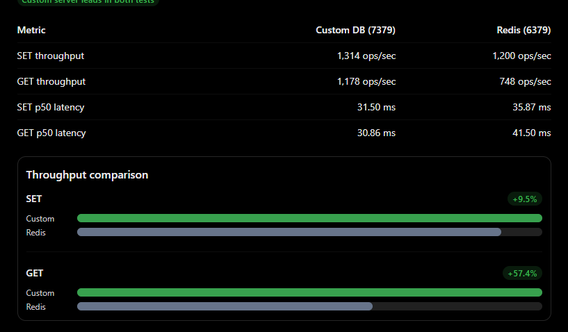

# minidis

A tiny Redis-compatible in-memory key-value server written in plain Java 21, with no dependencies.

minidis speaks **RESP2**, the Redis wire protocol, so `redis-cli`, `telnet` and `nc` all work against it out of the box. It is built as a learning project: small enough to read in one sitting, but with the same core ideas a real Redis uses (single-threaded command execution, lazy and active key expiry, a real protocol codec).

> **Status:** early development. More features are planned in upcoming commits (see the [Roadmap](#roadmap)).

---

## Highlights

- **Redis wire protocol (RESP2)**: parses array-of-bulk-string requests and also accepts inline commands, so you can talk to it from `nc`.
- **Lock-free keyspace**: all commands run on one dedicated executor thread, so the `Store` needs no locks.
- **Cheap concurrency for clients**: one virtual thread per connection (Project Loom); a single platform thread accepts.
- **Key expiry done properly**: lazy expiration on read, plus a background sweeper every 100 ms for keys nobody reads again.
- **Protocol hardening**: Redis-style limits on argument count, bulk size and inline line length.
- **Injectable clock**: `Store` takes a `LongSupplier`, which makes expiry logic easy to test deterministically.

## Quick start

**Requirements:** JDK 21 or newer (virtual threads, sealed interfaces and pattern-matching `switch` are used).

```bash
# compile
javac -d out *.java

# run (default port 7379)
java -cp out Server

# or choose a port
java -cp out Server 6380
```

Then connect:

```bash
redis-cli -p 7379
127.0.0.1:7379> PING
PONG
127.0.0.1:7379> SET greeting "hello" EX 30
OK
127.0.0.1:7379> GET greeting
"hello"
127.0.0.1:7379> TTL greeting
(integer) 30
```

No `redis-cli`? Plain netcat works too, thanks to inline command support:

```bash
printf 'PING\r\nSET a 1\r\nINCR a\r\nGET a\r\n' | nc localhost 7379
```

## Supported commands

| Command | Syntax | Notes |
|---|---|---|
| `PING` | `PING [message]` | Returns `PONG`, or the message as a bulk string |
| `ECHO` | `ECHO message` | |
| `COMMAND` | `COMMAND` | Returns an empty array (`redis-cli` sends this on connect) |
| `DBSIZE` | `DBSIZE` | Raw key count; may include expired keys not yet evicted |
| `SET` | `SET key value [EX seconds] [PX millis] [NX]` | Overwriting clears any previous TTL |
| `GET` | `GET key` | Returns nil if missing or expired |
| `DEL` | `DEL key [key ...]` | Returns number of keys removed |
| `EXISTS` | `EXISTS key [key ...]` | Returns number of keys that exist |
| `INCR` / `DECR` | `INCR key` | Missing key counts as 0; overflow-safe; keeps TTL |
| `INCRBY` | `INCRBY key delta` | |
| `EXPIRE` | `EXPIRE key seconds` | Returns 1 if the TTL was set, 0 if the key is missing |
| `PEXPIREAT` | `PEXPIREAT key millis` | See [known limitations](#known-limitations) |
| `TTL` | `TTL key` | `-2` no such key, `-1` no expiry, otherwise seconds (rounded up) |
| `KEYS` | `KEYS pattern` | Supports `*` and `?` globs |

Error replies follow Redis conventions (`ERR ...`, `WRONGTYPE ...`).

## Architecture

```
                 ┌────────────────────────────────────────────────┐
 client ──TCP──► │ acceptor (platform thread)                     │
                 │   └─ one virtual thread per connection         │
                 │        Resp.readCommand ─► List<String>        │
                 └───────────────────┬────────────────────────────┘
                                     │ submit(...)
                                     ▼
                 ┌────────────────────────────────────────────────┐
                 │ command-executor  (single thread)              │
                 │   Commands.execute ─► Store (HashMaps)         │
                 │   + sweepExpired() every 100 ms                │
                 └───────────────────┬────────────────────────────┘
                                     │ Reply
                                     ▼
                              Resp.write ─► socket
```

| File | Responsibility |
|---|---|
| `Server.java` | Accept loop, per-client virtual threads, scheduling the single command executor and the expiry sweeper |
| `Resp.java` | RESP2 codec: `readCommand` parses requests, `write` serialises replies, `writeCommand` encodes a command as an array (groundwork for AOF) |
| `Reply.java` | Sealed interface modelling the five RESP2 reply types (`Simple`, `Error`, `Int`, `Bulk`, `Array`) |
| `Commands.java` | Command table and handlers; turns `CommandException` into error replies |
| `Store.java` | The keyspace plus TTL bookkeeping. Deliberately **not** thread-safe |

### Why a single command thread?

Redis gets its simplicity and atomicity from executing commands one at a time. minidis does the same: network I/O is concurrent (virtual threads), but every command is funnelled through one executor. Each command is therefore atomic, `INCR` can't race with itself, and the `Store` needs no synchronisation.

### How expiry works

- **Lazy:** every `Store.get` checks the key's deadline first and deletes it if it has passed.
- **Active:** a scheduled task runs every 100 ms and checks up to 20 keys that have a TTL, evicting dead ones. Without this, keys that are never read again would leak memory.

## Benchmark



*Benchmark #1. Few more things are yet to be added will calculate this again.*

If you want to reproduce a run with the standard Redis tool:

```bash
redis-benchmark -p 7379 -t set,get,incr -n 100000 -c 50 -q
```

## Known limitations

This is an early version, and these are tracked for future commits:

- Only string values are supported (the store is typed `Object` so other types can be added).
- `PEXPIREAT` currently adds the argument to the current time instead of treating it as an absolute timestamp.
- `KEYS` converts globs to regex without escaping other regex characters, and doesn't support `[...]` classes.
- Active expiry always inspects the *first* N TTL entries rather than a random sample, so it can be starved by a large block of live keys.
- No persistence yet; all data is lost on restart.
- No pub/sub, transactions or replication.

## Roadmap

- [ ] Append-only file (AOF) persistence and replay (`Resp.writeCommand` is already in place)
- [ ] Random-sampling active expiry, as real Redis does
- [ ] More data types: lists, hashes, sets
- [ ] More commands (`MGET`, `MSET`, `APPEND`, `PERSIST`, `PTTL`, ...)
- [ ] Unit and integration test suite using the injectable clock
- [ ] Graceful shutdown and configuration via CLI flags

## Contributing

Issues and pull requests are welcome. Keep the code small and readable, since clarity is the main goal of the project.


